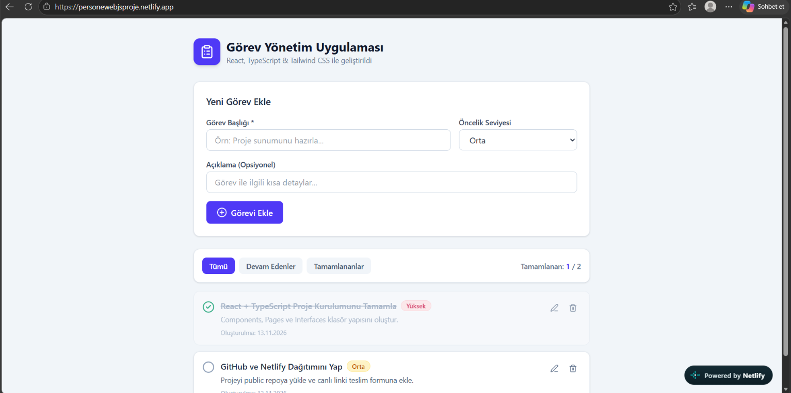

# React + TypeScript + Tailwind CSS Görev Yönetimi

## 🚀 Kurulum ve Çalıştırma Adımları

Projeyi kendi bilgisayarınızda yerel olarak çalıştırmak için aşağıdaki adımları takip edebilirsiniz:

1. **Projeyi klonlayın:**
   ```bash
   git clone [https://github.com/Nurkurtoglu/react-ts-todo-app.git](https://github.com/Nurkurtoglu/react-ts-todo-app.git)
Proje dizinine gidin:

Bash
cd react-ts-todo-app
Bağımlılıkları yükleyin:

Bash
npm install
Uygulamayı geliştirme modunda başlatın:

Bash
npm run dev
Tarayıcınızda açılan http://localhost:5173 adresi üzerinden uygulamayı test edebilirsiniz.


